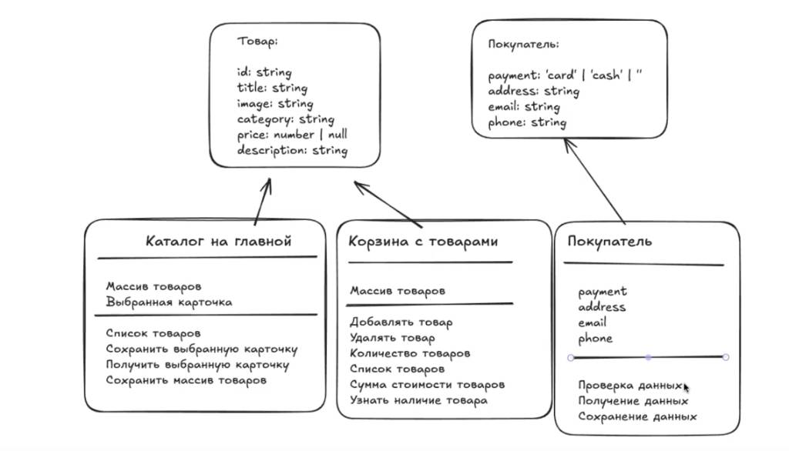

# Проектная работа "Веб-ларек"

Стек: HTML, SCSS, TS, Vite

Структура проекта:
- src/ — исходные файлы проекта
- src/components/ — папка с JS компонентами
- src/components/base/ — папка с базовым кодом

Важные файлы:
- index.html — HTML-файл главной страницы
- src/types/index.ts — файл с типами
- src/main.ts — точка входа приложения
- src/scss/styles.scss — корневой файл стилей
- src/utils/constants.ts — файл с константами
- src/utils/utils.ts — файл с утилитами


## Установка и запуск
Для установки и запуска проекта необходимо выполнить команды

```
npm install
npm run dev
```

или

```
yarn
yarn dev
```
## Сборка

```
npm run build
```

или

```
yarn build
```
# Интернет-магазин «Web-Larёk»
«Web-Larёk» — это интернет-магазин с товарами для веб-разработчиков, где пользователи могут просматривать товары, добавлять их в корзину и оформлять заказы. Сайт предоставляет удобный интерфейс с модальными окнами для просмотра деталей товаров, управления корзиной и выбора способа оплаты, обеспечивая полный цикл покупки с отправкой заказов на сервер.

## Архитектура приложения


Код приложения разделен на слои согласно парадигме MVP (Model-View-Presenter), которая обеспечивает четкое разделение ответственности между классами слоев Model и View. Каждый слой несет свой смысл и ответственность:

Model - слой данных, отвечает за хранение и изменение данных.  
View - слой представления, отвечает за отображение данных на странице.  
Presenter - презентер содержит основную логику приложения и  отвечает за связь представления и данных.

Взаимодействие между классами обеспечивается использованием событийно-ориентированного подхода. Модели и Представления генерируют события при изменении данных или взаимодействии пользователя с приложением, а Презентер обрабатывает эти события используя методы как Моделей, так и Представлений.

### Базовый код

#### Класс Component
Является базовым классом для всех компонентов интерфейса.
Класс является дженериком и принимает в переменной `T` тип данных, которые могут быть переданы в метод `render` для отображения.

Конструктор:  
`constructor(container: HTMLElement)` - принимает ссылку на DOM элемент за отображение, которого он отвечает.

Поля класса:  
`container: HTMLElement` - поле для хранения корневого DOM элемента компонента.

Методы класса:  
`render(data?: Partial<T>): HTMLElement` - Главный метод класса. Он принимает данные, которые необходимо отобразить в интерфейсе, записывает эти данные в поля класса и возвращает ссылку на DOM-элемент. Предполагается, что в классах, которые будут наследоваться от `Component` будут реализованы сеттеры для полей с данными, которые будут вызываться в момент вызова `render` и записывать данные в необходимые DOM элементы.  
`setImage(element: HTMLImageElement, src: string, alt?: string): void` - утилитарный метод для модификации DOM-элементов ``


#### Класс Api
Содержит в себе базовую логику отправки запросов.

Конструктор:  
`constructor(baseUrl: string, options: RequestInit = {})` - В конструктор передается базовый адрес сервера и опциональный объект с заголовками запросов.

Поля класса:  
`baseUrl: string` - базовый адрес сервера  
`options: RequestInit` - объект с заголовками, которые будут использованы для запросов.

Методы:  
`get(uri: string): Promise<object>` - выполняет GET запрос на переданный в параметрах ендпоинт и возвращает промис с объектом, которым ответил сервер  
`post(uri: string, data: object, method: ApiPostMethods = 'POST'): Promise<object>` - принимает объект с данными, которые будут переданы в JSON в теле запроса, и отправляет эти данные на ендпоинт переданный как параметр при вызове метода. По умолчанию выполняется `POST` запрос, но метод запроса может быть переопределен заданием третьего параметра при вызове.  
`handleResponse(response: Response): Promise<object>` - защищенный метод проверяющий ответ сервера на корректность и возвращающий объект с данными полученный от сервера или отклоненный промис, в случае некорректных данных.

#### Класс EventEmitter
Брокер событий реализует паттерн "Наблюдатель", позволяющий отправлять события и подписываться на события, происходящие в системе. Класс используется для связи слоя данных и представления.

Конструктор класса не принимает параметров.

Поля класса:  
`_events: Map<string | RegExp, Set<Function>>)` -  хранит коллекцию подписок на события. Ключи коллекции - названия событий или регулярное выражение, значения - коллекция функций обработчиков, которые будут вызваны при срабатывании события.

Методы класса:  
`on<T extends object>(event: EventName, callback: (data: T) => void): void` - подписка на событие, принимает название события и функцию обработчик.  
`emit<T extends object>(event: string, data?: T): void` - инициализация события. При вызове события в метод передается название события и объект с данными, который будет использован как аргумент для вызова обработчика.  
`trigger<T extends object>(event: string, context?: Partial<T>): (data: T) => void` - возвращает функцию, при вызове которой инициализируется требуемое в параметрах событие с передачей в него данных из второго параметра.

## Типы данных (`src/types/index.ts`)

Для обеспечения строгой типизации в приложении выделены следующие интерфейсы и типы:

- `TPayment` — тип, описывающий доступные виды оплаты (`'card' | 'cash' | ''`).
- `FormErrors` — вспомогательный тип для хранения ошибок валидации полей формы заказа.
- `IProduct` — интерфейс, описывающий структуру данных товара, получаемого с сервера:
  - `id: string` — уникальный идентификатор товара.
  - `description: string` — детальное описание товара.
  - `image: string` — ссылка на изображение товара.
  - `title: string` — название товара.
  - `category: string` — категория товара.
  - `price: number | null` — стоимость товара в синапсах (может быть `null` для бесценных/недоступных товаров).
- `IBuyer` — интерфейс, описывающий данные покупателя:
  - `payment: TPayment` — выбранный способ оплаты.
  - `address: string` — адрес доставки.
  - `email: string` — электронная почта.
  - `phone: string` — номер телефона.
- `IOrderPost` — тип для объекта, отправляемого на сервер при оформлении заказа (объединяет `IBuyer`, массив ID товаров `items: string[]` и итоговую сумму `total: number`).
- `IProductsResponse` — тип объекта ответа сервера при запросе каталога товаров (содержит общее количество `total: number` и массив `items: IProduct[]`).
- `IOrderResult` — тип объекта ответа сервера при успешном оформлении покупки (содержит `id: string` и итоговую сумму `total: number`).

---

## Модели данных (Слой Model)

Классы этого слоя отвечают исключительно за хранение и управление данными приложения. Они изолированы от верстки, интерфейса отображения и напрямую не зависят от коммуникационного слоя. Доступ к защищенным полям классов осуществляется только через их публичные методы.

### 1. Класс `Products` (Каталог товаров)
Отвечает за хранение массива всех доступных товаров интернет-магазина и управление товаром, выбранным для подробного отображения.
- **Конструктор:** Не принимает параметров при инициализации.
- **Поля класса:**
  - `protected items: IProduct[]` — массив всех товаров.
  - `protected preview: IProduct | null` — товар, выбранный для просмотра в модальном окне.
- **Методы класса:**
  - `setItems(items: IProduct[]): void` — сохранение массива товаров, полученного в параметрах метода.
  - `getItems(): IProduct[]` — получение массива товаров из модели.
  - `getProduct(id: string): IProduct | undefined` — получение одного товара по его уникальному `id`.
  - `setPreview(item: IProduct | null): void` — сохранение товара для подробного отображения.
  - `getPreview(): IProduct | null` — получение объекта товара, выбранного для подробного отображения.

### 2. Класс `Basket` (Корзина с покупками)
Отвечает за хранение товаров, которые пользователь выбрал для покупки, и расчет их параметров.
- **Конструктор:** Не принимает параметров при инициализации.
- **Поля класса:**
  - `protected items: IProduct[]` — массив товаров, добавленных в корзину.
- **Методы класса:**
  - `getItems(): IProduct[]` — получение массива товаров, которые находятся в корзине.
  - `add(product: IProduct): void` — добавление товара, полученного в параметре, в массив корзины.
  - `remove(id: string): void` — удаление товара, полученного в параметре, из массива корзины по его `id`.
  - `clear(): void` — полная очистка корзины.
  - `getTotal(): number` — получение суммарной стоимости всех товаров в корзине.
  - `getCount(): number` — получение общего количества товаров в корзине.
  - `isInBasket(id: string): boolean` — проверка наличия товара в корзине по его `id`, полученному в параметр метода.

### 3. Класс `User` (Данные покупателя)
Отвечает за сбор данных покупателя из форм оформления и проведение проверок на обязательность заполнения полей.
- **Конструктор:** Не принимает параметров при инициализации.
- **Поля класса:**
  - `protected order: IBuyer` — объект, хранящий текущие данные покупателя (`payment`, `address`, `email`, `phone`).
- **Методы класса:**
  - `setField(field: keyof IBuyer, value: string): void` — точечное сохранение данных в модели. Позволяет обновить значение конкретного поля, не удаляя и не затирая данные других полей.
  - `getUserData(): IBuyer` — получение всех накопленных данных покупателя.
  - `clearUserData(): void` — полная очистка (сброс) данных покупателя до дефолтных значений.
  - `validateOrder(): FormErrors` — валидация полей первого шага (способ оплаты и адрес). Возвращает объект с текстами ошибок для незаполненных полей.
  - `validateContacts(): FormErrors` — валидация полей второго шага (email и телефон). Возвращает объект с текстами ошибок для незаполненных полей.

---

## Слой коммуникации (Класс LarekAPI)

Класс `LarekAPI` является представителем коммуникационного слоя приложения и отвечает за непосредственное сетевое взаимодействие с бэкенд-сервером интернет-магазина. Он использует интерфейс `IApi` по принципу внедрения зависимостей, обеспечивая слабую связанность между компонентами.

- **Конструктор:**
  - `constructor(api: IApi)` — Принимает объект, соответствующий интерфейсу `IApi`, для выполнения сетевых запросов.
- **Поля класса:**
  - `protected api: IApi` — экземпляр для работы с базовыми сетевыми методами.
- **Методы класса:**
  - `getProducts(): Promise<IProductsResponse>` — выполняет GET-запрос на эндпоинт `/product/` и возвращает сырой объект ответа от сервера с массивом товаров без промежуточных преобразований.
  - `orderProducts(order: IOrderPost): Promise<IOrderResult>` — выполняет POST-запрос на эндпоинт `/order/`, передавая данные о заказе в теле запроса, и возвращает подтверждающий объект от сервера.

## Компоненты представления (Слой View)

Классы этого слоя отвечают за отображение данных в DOM и реакцию на действия пользователя. Они не хранят бизнес-данные напрямую и взаимодействуют с остальной частью приложения только через события брокера `EventEmitter`. Все классы наследуются от базового `Component<T>`.

### Класс `Card`
Базовый класс карточки товара, общий для карточек на витрине, в превью и в корзине.
- **Конструктор:** `constructor(container: HTMLElement, actions?: ICardActions)` — принимает корневой DOM-элемент карточки и опциональный объект с обработчиком клика.
- **Поля класса:**
  - `protected _title: HTMLElement` — элемент заголовка карточки.
  - `protected _price: HTMLElement` — элемент цены карточки.
- **Методы класса:**
  - `set title(value: string)` / `get title(): string` — запись и чтение заголовка карточки.
  - `set price(value: number | null)` — отображает цену в формате `"N синапсов"` или `"Бесценно"`, если `price === null`.

### Класс `CardCatalog`
Наследник `Card`, карточка товара на витрине каталога.
- **Конструктор:** `constructor(container: HTMLElement, actions?: ICardActions)`.
- **Поля класса:**
  - `protected _image: HTMLImageElement` — изображение товара.
  - `protected _category: HTMLElement` — элемент категории товара.
- **Методы класса:**
  - `set image(value: string)` — устанавливает изображение и alt-текст (из `title`).
  - `set category(value: string)` — выводит текст категории и добавляет CSS-модификатор согласно `categoryMap`.

### Класс `CardPreview`
Наследник `CardCatalog`, карточка товара для подробного просмотра в модальном окне.
- **Конструктор:** `constructor(container: HTMLElement, actions?: ICardActions)`.
- **Поля класса:**
  - `protected _description: HTMLElement` — описание товара.
  - `protected _buyButton: HTMLButtonElement` — кнопка покупки/удаления.
- **Методы класса:**
  - `set price(value: number | null)` — переопределяет сеттер родителя: дополнительно блокирует кнопку покупки и меняет её текст на «Недоступно», если `price === null`.
  - `set description(value: string)` — устанавливает текст описания товара.
  - `set buttonText(value: string)` — устанавливает текст кнопки покупки/удаления.

### Класс `CardBasket`
Наследник `Card`, строка товара внутри корзины.
- **Конструктор:** `constructor(container: HTMLElement, actions?: ICardActions)`.
- **Поля класса:**
  - `protected _index: HTMLElement` — порядковый номер товара в списке.
  - `protected _deleteButton: HTMLButtonElement` — кнопка удаления товара из корзины.
- **Методы класса:**
  - `set index(value: number)` — устанавливает

## Слой Презентера (Presenter)

Роль Презентера выполняет основной скрипт приложения `src/main.ts`. Он не выделяется в отдельный класс и выступает в качестве главного диспетчера, связывающего модели данных и компоненты представления через систему событий (брокер событий `EventEmitter`).

Презентер инициализирует брокер событий, все необходимые модели данных, базовые сетевые сервисы и корневые компоненты интерфейса (главную страницу, модальное окно). Он подписывается на события, генерируемые как моделями данных (при их обновлении), так и компонентами представления (при действиях пользователя), и координирует их совместную работу согласно бизнес-логике интернет-магазина.

## Список событий в приложении (Event List)

В приложении используется событийно-ориентированный подход на базе брокера событий `EventEmitter`. Ниже приведен полный список сигналов, связывающих Модели данных и Компоненты представления:

### События Моделей данных (Model)
* `items:changed` — вызывается моделью каталога при успешной загрузке или обновлении массива товаров с сервера. Сигнализирует о необходимости перерисовать витрину на главной странице.
* `preview:changed` — вызывается моделью каталога при выборе конкретного товара для подробного осмотра. Передает объект выбранного товара для отображения в модальном окне.
* `basket:changed` — вызывается моделью корзины при любом изменении состава товаров (добавление, удаление, очистка). Триггерит пересчет счетчика в шапке сайта и обновление списка строк в окне корзины.
* `formErrors:change` — вызывается моделью пользователя при изменении любого поля в формах. Передает объект с актуальными ошибками валидации для динамической блокировки кнопок отправки.

### События Компонентов представления (View)
* `basket:open` — генерируется главной страницей при клике пользователя на иконку корзины в шапке. Сигнализирует о необходимости открыть модальное окно корзины.
* `card:select` — генерируется карточкой на витрине при клике по ней пользователем для открытия подробного превью товара.
* `card:buy` — генерируется кнопкой в модальном окне превью товара при желании пользователя добавить позицию в корзину.
* `card:remove` — генерируется кнопкой-мусоркой в строке товара внутри корзины при намерении пользователя удалить товар из списка покупок.
* `order:open` — генерируется кнопкой «Оформить» внутри корзины. Переводит интерфейс на первый шаг заполнения данных (выбор оплаты и ввод адреса).
* `order.payment:change` / `order.address:change` — генерируются формой заказа при интерактивном вводе адреса или выборе способа оплаты пользователем.
* `order:submit` — генерируется при нажатии кнопки «Далее» на форме заказа, сигнализируя о переходе ко второму шагу.
* `contacts.email:change` / `contacts.phone:change` — генерируются формой контактов при заполнении пользователем полей почты и телефона.
* `contacts:submit` — генерируется при нажатии кнопки «Оплатить», инициируя сборку итогового объекта заказа и его отправку на сервер через API.
* `modal:open` / `modal:close` — генерируются классом `Modal` при открытии и закрытии модального окна соответственно.